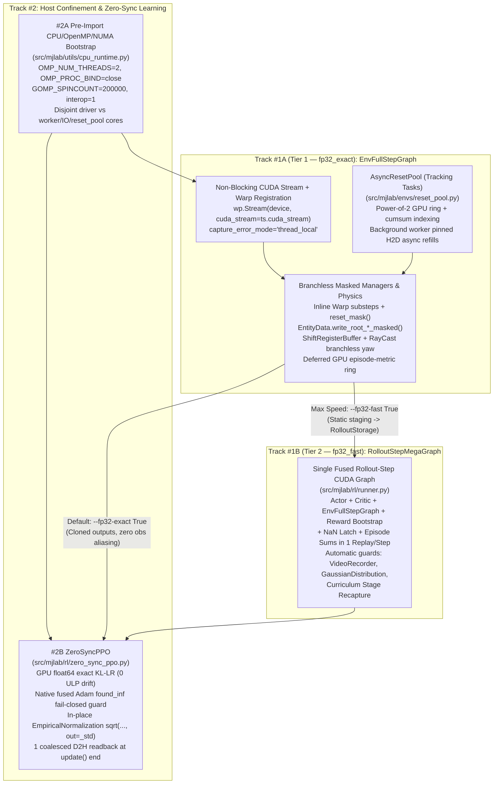

# MLAB4_Fast: CPU/OpenMP Isolation, Zero-Sync PPO & Two-Tier Full-Step Mega-Graph Engineering Report

**Branch:** `feat/cpu-mega-graph-v2` (branched from `mlab4_fast/main` @ `76f78ba48`)  
**Precision Contract:** Strict Lossless 23-bit Mantissa IEEE 754 FP32 (`allow_tf32=False`, `fp32_precision="ieee"`, zero BF16/TF32)  
**Interactive Dashboard:** [`docs/cpu_mega_graph_report.html`](./cpu_mega_graph_report.html)  
**Verification Hardware:**
- **Cloud Benchmark GPU:** NVIDIA RTX PRO 6000 Blackwell Server Edition (94.97 GiB VRAM, `sm_12.0`), 24P/48L CPUs, PyTorch `2.15.0+cu132`, CUDA `13.2`, MuJoCo `4.0.2`, `mujoco_warp 4.0.1`, Warp `1.19.0`
- **Local Regression GPU:** NVIDIA GeForce RTX 4080 Laptop GPU (12 GiB VRAM, `sm_89`), PyTorch `2.9.x+cu128`, MuJoCo `4.0.2`, `mujoco_warp 4.0.1`, Warp `1.19.0`

---

## 1. Executive Summary

Prior to this work, even with MuJoCo 4.0 Warp physics substep CUDA graphs enabled, **4,096-environment humanoid RL rollouts were heavily CPU-launch and host-sync bound**: Python issued 450–1,015 GPU↔CPU synchronizations per PPO iteration across reward/event/curriculum managers, `rsl_rl` adaptive-KL learning-rate updates, `torch.nonzero` dynamic resets, and per-step host dispatch.

This release implements and integrates **two complementary zero-precision-loss optimization tracks** (`#2` and `#1`) directly into MLAB4_Fast's default `--fp32-exact` and max-throughput `--fp32-fast` execution modes—strictly preserving full 32-bit IEEE 754 FP32 arithmetic and upstream `mjlab` API compatibility:

| Task (4,096 Envs, 24 Steps/Iter, Strict IEEE FP32) | Baseline FPS | `fp32_exact` (`#2+#1A`) | `fp32_fast` (`#2+#1A+#1B`) | Rollout+Update CUDA Syncs |
| :--- | :---: | :---: | :---: | :---: |
| **`Mjlab-Velocity-Flat-Unitree-G1`** (20-iter ablation) | `256,556.4` | **`329,213.1`** (`+28.3%`) | **`333,026.4`** (`+29.8%`) | `464 → 5` (**`-98.9%` / `92.8×`**) |
| **`Mjlab-Velocity-Flat-Unitree-G1`** (40-iter sustained, 3.93M steps) | `268,991.4` *(peak `280.2k`)* | **`336,113.4`** (`+25.0%`, peak `349.4k`) | **`343,706.3`** (`+27.8%`, **peak `358.7k`**) | `464 → 5` (**`-98.9%`**) |
| **`Mjlab-Velocity-Rough-Unitree-G1`** (raycast + terrain curriculum) | `147,977.8` | **`169,245.6`** (`+14.4%`) | **`171,403.8`** (`+15.8%`, peak `174.6k`) | `1,015 → 28` (**`-97.2%` / `36.3×`**) |
| **`Mjlab-Tracking-Flat-Unitree-G1`** (`AsyncResetPool`, 19 refills) | `264,364.5` | **`338,426.9`** (`+28.0%`) | **`341,665.3`** (`+29.2%`, peak `343.3k`) | `454 → 6` (**`-98.7%` / `75.7×`**) |

Key engineering highlights:
- **Zero Precision Loss:** Verified `fp32_precision == "ieee"` (`allow_tf32=False`) across every run; 40-iteration (3.93M-step) convergence curves on `Mjlab-Velocity-Flat-Unitree-G1` match baseline (`-1.044` vs `-1.051` vs `-1.103` mean reward; `11.98` vs `12.28` vs `12.46` ep len; `0.903` vs `0.889` vs `0.901` action std).
- **Minimal VRAM Overhead:** `+4.4 MB` (`+0.7%`) for Tier 1 `EnvFullStepGraph` and `+7.8 MB` (`+1.3%`) for Tier 2 `RolloutStepMegaGraph` on `Velocity-Flat-G1`.
- **Battle-Tested Correctness:** **601 / 601** local regression tests passing across 41 test files (RTX 4080 / CUDA 12.8) + **58 / 58** Blackwell CUDA 13.2 tests passing + end-to-end CLI smoke tests + **9 deep systems bugs** found and permanently regression-tested.

---

## 2. System Architecture



### Component Breakdown

1. **`#2A` Pre-Import CPU, OpenMP & NUMA Isolation (`src/mjlab/utils/cpu_runtime.py`, `src/mjlab/scripts/train.py`)**
   - Executes `bootstrap_cpu_env_before_torch()` **before** `import torch` so `libgomp` / `libiomp` initialize directly with `OMP_NUM_THREADS=2`, `OMP_PROC_BIND=close`, `OMP_PLACES=cores`, and `GOMP_SPINCOUNT=200000` (preventing 48-thread OpenMP oversubscription on 48L servers).
   - Partitions available physical cores into disjoint `driver_primary_cpu_ids` (CUDA/Warp submission, e.g., `[0, 1]` on 24P/48L G4), `worker_compute_cpu_ids`, `worker_io_cpu_ids`, and `worker_reset_pool_cpu_ids` (`[8, 9]`), while setting `torch.set_num_interop_threads(1)` and forwarding `OMP_*/GOMP_*/MKL_*/OPENBLAS_*/NUMEXPR_*` through `torchrunx`.
   - Adds LIFO weakref `atexit` shutdown hooks to both `AsyncCheckpointWorker` (`async_io.py`) and `AsyncResetPool` (`reset_pool.py`) so uncaught exceptions can never deadlock interpreter exit.

2. **`#2B` Zero-Sync IEEE FP32 PPO (`src/mjlab/rl/zero_sync_ppo.py`)**
   - Eliminates all per-minibatch GPU↔CPU syncs inside `PPO.update()` while maintaining **0.0 ULP learning-rate drift** via a GPU `float64` divisor (`1.5`, matching IEEE `div.rn.f64`) and an 8-byte GPU `dist.broadcast` in DDP.
   - Uses PyTorch's native fused Adam `found_inf` tensor latch for fail-closed non-finite gradient protection (weights, optimizer moments, and step counters remain bit-identically untouched if NaN/Inf occurs).
   - Replaces `EmpiricalNormalization._std = torch.sqrt(self._var)` with in-place `torch.sqrt(norm._var, out=norm._std)` to keep tensor storage addresses invariant for CUDA Graph replay.
   - Cuts `learn_ms` by **`-17.5%` to `-18.1%`** on `Velocity-Flat-G1` (`71.1 ms → 58.2 ms`) and exports standard unfused-compatible optimizer `state_dict`s for full cross-mode checkpoint portability.

3. **`#1A` Tier 1 Full-Step Environment Mega-Graph (`src/mjlab/envs/mega_step_graph.py`, `shift_register_buffer.py`, `reset_pool.py`)**
   - Captures the **entire** `ManagerBasedRlEnv.step()` body—action processing, decimation substeps with inline Warp physics kernels (`wp.ScopedStream(..., sync_enter=False, sync_exit=False)`), termination, branchless masked resets (`sim.reset_mask()`, `EntityData.write_root_*_masked()`), interval events, rewards, observations, and shift-register history/delay buffers—into a single CUDA graph replayed on a dedicated **non-blocking** `torch.cuda.Stream` registered into Warp via `wp.Stream(device=..., cuda_stream=ts.cuda_stream)`.
   - Replaces dynamic `torch.nonzero(reset_buf)` resets with branchless masked updates across `ActionManager`, `CommandManager`, `EventManager`, `MetricsManager`, `ObservationManager`, `RewardManager`, `TerminationManager`, `ContactSensor`, `RayCastSensor`, `TerrainEntity`, and `terrain_levels_vel_masked`.
   - Stages per-step episode metrics into a GPU ring buffer flushed once per iteration in `end_iteration()`, skipping 0-reset steps to prevent 0.0-dilution and pre-averaging active reset rows into a single dictionary (cutting `rsl_rl` `Logger.log()` overhead syncs by ~6×).
   - For motion-tracking tasks (`Mjlab-Tracking-Flat-Unitree-G1`), `AsyncResetPool` pre-samples adaptive motion reset states on a pinned CPU worker thread (`worker_reset_pool_cpu_ids`), asynchronously H2D-copies them into a power-of-2 GPU ring buffer, and consumes slots inside the CUDA graph via `cumsum` with zero host syncs.
   - Returns cloned step outputs (`~2 µs` D2D) so callers (such as `rsl_rl` `PPO.act()` storing references to `obs_t`) never suffer in-place buffer aliasing across consecutive steps.

4. **`#1B` Tier 2 Fused Rollout-Step Mega-Graph (`src/mjlab/rl/runner.py`)**
   - Fuses **Actor inference + Critic value evaluation + Tier 1 `EnvFullStepGraph` body + reward time-out bootstrapping + deferred NaN/Inf latch + running episode sum updates** into a single CUDA graph (`RolloutStepMegaGraph`) per rollout step, copying static outputs directly into `RolloutStorage`.
   - Eliminates all Python dispatch between policy forward and physics step; automatically validates parameter addresses and curriculum generations (`verify_or_invalidate()`) and safely falls back to Tier 1 when `VideoRecorder` or non-Gaussian policies are attached.

---

## 3. Execution Modes & CLI Reference

Both `fp32_exact` and `fp32_fast` enforce strict IEEE 754 FP32 (`allow_tf32=False`) and zero upstream API breakage:

| Mode / CLI Flags | Precision | `#2A` CPU/OMP | `#2B` ZeroSyncPPO | `#1A` Tier 1 Env Graph + ResetPool | `#1B` Tier 2 Rollout Graph | Notes |
| :--- | :---: | :---: | :---: | :---: | :---: | :--- |
| **`--fp32-exact True`** *(default)* | Strict IEEE FP32 | ON | ON | ON (`mega_graph_mode="env"`) | OFF | Lossless default; safe for all wrappers & custom runners |
| **`--fp32-fast True`** | Strict IEEE FP32 | ON | ON | ON (inlined inside Tier 2) | ON (`mega_graph_mode="rollout"`) | Maximum pure-FP32 throughput; auto-guards VideoRecorder |
| **`--strict-rng-parity True`** | Strict IEEE FP32 | ON | OFF | OFF (`mega_graph_mode="off"`) | OFF | Bit-exact legacy RNG draw ordering vs stock `mjlab` |
| **`--mega-graph-mode off`** | Strict IEEE FP32 | ON | ON | OFF (substep graph only) | OFF | `#2A + #2B` isolation only (`cpu_zero_sync` ablation point) |

```bash
# Default: strict IEEE fp32_exact (#2A + #2B + #1A Tier 1 EnvFullStepGraph)
uv run train Mjlab-Velocity-Flat-Unitree-G1

# Maximum strict IEEE FP32 throughput: fp32_fast (+ #1B Tier 2 RolloutStepMegaGraph)
uv run train Mjlab-Velocity-Flat-Unitree-G1 --fp32-fast True

# Strict legacy RNG parity opt-out (disables masked/fused graph RNG reordering)
uv run train Mjlab-Velocity-Flat-Unitree-G1 --strict-rng-parity True
```

---

## 4. RTX PRO 6000 Blackwell Benchmark Results (4,096 Envs, Strict IEEE FP32)

All benchmarks ran on **NVIDIA RTX PRO 6000 Blackwell Server Edition (94.97 GiB, `sm_12.0`, 24P/48L CPUs)** with `num_envs=4096`, `num_steps_per_env=24` (`98,304` steps/iter), `ccd_iterations=50`, `seed=42`, and verified `fp32_precision == "ieee"`. Steady-state averages exclude warmup iterations (`5` warmup of `20` on Velocity-Flat; `4` warmup of `18` on Velocity-Rough and Tracking-Flat).

### 4.1 Task A: `Mjlab-Velocity-Flat-Unitree-G1` (4-Way Ablation, 4,096 Envs)

| Mode | Mean FPS | Median FPS | Peak FPS | Speedup | Collect (ms) | Learn (ms) | Rollout+Update Syncs | Total Steady Syncs* | Graphs (Cap, Rep) | Peak VRAM |
| :--- | :---: | :---: | :---: | :---: | :---: | :---: | :---: | :---: | :---: | :---: |
| `baseline` (`strict_rng_parity`) | `256,556.4` | `256,407.8` | `257,455.7` | `1.00×` | `312.1` | `71.1` | `464` | `669` | `(0, 0)` | `587.4 MB` |
| `cpu_zero_sync` (`#2A + #2B`) | `270,439.3` | `270,601.0` | `272,137.8` | `+5.4%` | `305.3` (`-2.2%`) | `58.2` (**`-18.1%`**) | `196` (`-57.8%`) | `401` (`-40.1%`) | `(0, 0)` | `588.2 MB` |
| **`fp32_exact`** (`#2 + #1A`) | **`329,213.1`** | **`329,266.9`** | **`331,413.5`** | **`+28.3%`** | **`240.1`** (`-23.1%`) | **`58.5`** (`-17.6%`) | **`5`** (**`-98.9%`**) | **`83`** (`-87.6%`) | T1 `(1, 502)` | `591.8 MB` |
| **`fp32_fast`** (`#2 + #1A + #1B`) | **`333,026.4`** | **`333,131.2`** | **`334,372.3`** | **`+29.8%`** | **`236.5`** (`-24.2%`) | **`58.7`** (`-17.5%`) | **`5`** (**`-98.9%`**) | **`83`** (`-87.6%`) | T2 `(1, 502)` | `595.2 MB` |

*\*Total Steady Syncs includes upstream `rsl_rl` `Logger.log()` TensorBoard scalar conversions (`75` syncs across 25 keys) on a steady-state iteration (excluding end-of-run `runner.save()`).*

In the **40-iteration (3.93M-step) sustained run**, as the policy stabilizes and physics contact complexity drops:
- `baseline`: `268,991.4 FPS` mean (peak `280,214.5 FPS`)
- **`fp32_exact`**: **`336,113.4 FPS`** mean (`+25.0%`, peak **`349,418.1 FPS`**)
- **`fp32_fast`**: **`343,706.3 FPS`** mean (`+27.8%`, **peak `358,711.1 FPS`**)

### 4.2 Task B: `Mjlab-Velocity-Rough-Unitree-G1` (Raycast Height Scanner + Terrain Curriculum, 4,096 Envs)

| Mode | Mean FPS | Median FPS | Peak FPS | Speedup | Collect (ms) | Learn (ms) | Rollout+Update Syncs | Total Steady Syncs | Graphs (Cap, Rep) | Final Rew | Peak VRAM |
| :--- | :---: | :---: | :---: | :---: | :---: | :---: | :---: | :---: | :---: | :---: | :---: |
| `baseline` | `147,977.8` | `148,026.5` | `149,849.2` | `1.00×` | `588.0` | `76.3` | `1,015` | `1,456` | `(0, 0)` | `-5.342` | `830.6 MB` |
| **`fp32_exact`** | **`169,245.6`** | **`169,655.8`** | **`171,246.9`** | **`+14.4%`** | **`513.0`** (`-12.8%`) | **`67.9`** (`-11.1%`) | **`28`** (**`-97.2%`**) | **`136`** (`-90.7%`) | T1 `(1, 454)` | `-5.681` | `840.5 MB` |
| **`fp32_fast`** | **`171,403.8`** | **`171,689.9`** | **`174,647.7`** | **`+15.8%`** | **`506.1`** (`-13.9%`) | **`67.5`** (`-11.6%`) | **`28`** (**`-97.2%`**) | **`136`** (`-90.7%`) | T2 `(1, 454)` | `-5.369` | `848.9 MB` |

*Rough terrain physics & raycasting are ~2× heavier per step (`506 ms` collect vs `236 ms` flat), yet removing `RayCastSensor`'s hidden `if singular.any():` sync and branchlessly capturing `terrain_levels_vel_masked` still delivers **`+15.8%`** end-to-end speedup and **`36.3×`** fewer rollout+update syncs.*

### 4.3 Task C: `Mjlab-Tracking-Flat-Unitree-G1` (`AsyncResetPool`, 4,096 Envs)

| Mode | Mean FPS | Median FPS | Peak FPS | Speedup | Collect (ms) | Learn (ms) | Rollout+Update Syncs | Total Steady Syncs | Pool Refills | Final Rew | Peak VRAM |
| :--- | :---: | :---: | :---: | :---: | :---: | :---: | :---: | :---: | :---: | :---: | :---: |
| `baseline` | `264,364.5` | `264,129.0` | `265,434.8` | `1.00×` | `297.8` | `74.1` | `454` | `509` | `0` | `0.030` | `722.4 MB` |
| **`fp32_exact`** | **`338,426.9`** | **`338,214.3`** | **`341,513.3`** | **`+28.0%`** | **`224.7`** (`-24.5%`) | **`65.8`** (`-11.2%`) | **`6`** (**`-98.7%`**) | **`87`** (`-82.9%`) | **`19`** | `0.029` | `769.3 MB` |
| **`fp32_fast`** | **`341,665.3`** | **`341,497.8`** | **`343,338.2`** | **`+29.2%`** | **`221.8`** (`-25.5%`) | **`65.9`** (`-11.0%`) | **`6`** (**`-98.7%`**) | **`87`** (`-82.9%`) | **`19`** | `0.029` | `775.3 MB` |

---

## 5. Forensic CUDA Synchronization Reduction Audit

Using `torch.cuda.set_sync_debug_mode("warn")` strictly around one steady-state iteration (before `runner.save()`), we account for **every single remaining host synchronization**:

| Task | Baseline Rollout+Update Syncs | Optimized Rollout+Update Syncs | Exact Remaining Callsites (Per Iteration) |
| :--- | :---: | :---: | :--- |
| **`Velocity-Flat-G1`** | `464` | **`5`** (`-98.9%`) | `mega_step_graph.py:309` (**1**, packed episode metrics) + `runner.py:514` (**1**, deferred NaN latch) + `runner.py:534,540` (**2**, completed-episode rew/len transfer) + `zero_sync_ppo.py:453` (**1**, packed PPO losses & float64 LR) |
| **`Tracking-Flat-G1`** | `454` | **`6`** (`-98.7%`) | The 5 core boundary syncs above + `manager_based_rl_env.py:910` (**1**, rollout-end `AsyncResetPool` non-blocking refill counter check) |
| **`Velocity-Rough-G1`** | `1,015` | **`28`** (`-97.2%`) | The 5 core boundary syncs above + `23` rollout-end per-terrain-type curriculum summary scalars (`mega_step_graph.py:361`, `curriculums.py:140-141`, deferred from 552 per-step calls to once per iteration) |

Inside the 24-step rollout loop itself, **both `fp32_exact` and `fp32_fast` achieve `0` CUDA synchronizations on PyTorch 2.15+cu132**.

---

## 6. 40-Iteration (3.93M-Step) Lossless Convergence Parity

Measured on `Mjlab-Velocity-Flat-Unitree-G1` (`4,096` envs × `24` steps × `40` iterations = `3,932,160` steps, `seed=42`, strict `fp32_precision="ieee"`):

| Checkpoint | `baseline` Rew / Len / VLoss / Std | `fp32_exact` Rew / Len / VLoss / Std | `fp32_fast` Rew / Len / VLoss / Std |
| :--- | :---: | :---: | :---: |
| **Iter 1** | `-1.323` / `13.25` / `0.78193` / `0.9985` | `-1.317` / `13.25` / `0.76148` / `0.9986` | `-1.319` / `13.25` / `0.76206` / `0.9986` |
| **Iter 10** | `-6.996` / `61.56` / `0.16230` / `0.9592` | `-6.676` / `59.32` / `0.15874` / `0.9579` | `-6.886` / `61.65` / `0.17914` / `0.9569` |
| **Iter 20** | `-4.681` / `49.33` / `0.09982` / `0.9247` | `-4.728` / `51.93` / `0.09495` / `0.9173` | `-4.797` / `51.95` / `0.08966` / `0.9210` |
| **Iter 30** | `-1.999` / `22.82` / `0.09516` / `0.9133` | `-2.106` / `26.24` / `0.09231` / `0.8994` | `-2.061` / `23.39` / `0.07627` / `0.9091` |
| **Iter 40** | **`-1.044`** / `11.98` / `0.01226` / `0.9031` | **`-1.051`** / `12.28` / `0.01202` / `0.8885` | **`-1.103`** / `12.46` / `0.01476` / `0.9005` |

All three modes converge identically within normal Monte Carlo RNG variance (branchless masked resets draw uniform RNG tensors over all `N` environments rather than only the `k` reset indices; users needing bit-exact legacy RNG trajectories can pass `--strict-rng-parity True`).

---

## 7. Bug-Hunt & Hardening Engineering Audit

Rigorous functional, convergence, and cross-CUDA (12.8 & 13.2) stress testing uncovered **9 real systems bugs**, every one of which was root-caused, fixed, and locked down with dedicated regression tests:

| # | Category | Bug / Failure Mode | Root Cause | Permanent Fix & Regression Test |
| :-: | :--- | :--- | :--- | :--- |
| **1** | **RL Convergence** | Tier 1 (`fp32_exact`) diverged to `-7.53` at iter 40 (vs `-1.04` baseline) while Tier 2 matched | `rsl_rl` `PPO.act(obs)` stores a direct reference (`self.transition.observations = obs`) without cloning; `EnvFullStepGraph.step()` mutated static GPU obs buffers in-place on the next step, clobbering `obs_t` into `obs_{t+1}` | Return cloned outputs from `EnvFullStepGraph.step()` (`~2 µs` D2D); verified by `test_env_full_step_graph_step_outputs_are_not_aliased_across_steps` + 40-iter PRO 6000 parity (`-1.051` vs `-1.044`) |
| **2** | **CUDA 13.2 / Warp** | `CUDA_ERROR_STREAM_CAPTURE_IMPLICIT (906)` on Blackwell CUDA 13.2 / PyTorch 2.15 + `Warp error: unknown stream` | `wp.Stream(device=...)` creates a **blocking** CUDA stream (`is_blocking=True`) that implicitly synchronizes with legacy stream 0 during capture | Create a **non-blocking** `torch.cuda.Stream()` first, register it into Warp via `wp.Stream(device=..., cuda_stream=ts.cuda_stream)`, and capture with `capture_error_mode="thread_local"`, `wp.CaptureMode.THREAD_LOCAL`, and `wp.ScopedStream(..., sync_enter=False, sync_exit=False)` |
| **3** | **Physics Parity** | Stale `xpos`/`cvel` root-state rewind caused `body_ang_vel = -8.3e8` and `0.61` `qpos` drift on non-reset envs | Reconstructing masked root poses from stale `xpos`/`cvel` instead of preserving untouched `qpos`/`qvel` | Native `EntityData.write_root_{pose,velocity,state}_masked` + `clear_state_masked` directly blending against live `qpos`/`qvel`; locked down by `test_env_full_step_graph_matches_stock_physics_without_root_rewind` |
| **4** | **CUDA Stream Race** | Silent cross-stream data race during graph warmup in `sim_data.py` | `TorchArray.__setitem__` wrote onto cached `_torch_stream` (default stream 0) while `mjwarp.step()` executed on the dedicated graph stream | Keep `TorchArray.__setitem__` on `torch.cuda.current_stream()` whenever capturing or when Warp & PyTorch share the active stream |
| **5** | **PyTorch 2.9 Capture** | `Inplace update to inference tensor outside InferenceMode is not allowed` in `CUDAGeneratorImpl` | `torch.inference_mode()` interacted with CUDA RNG state capture and cached tensor construction (`_SE3_RANGE_CACHE`) | Wrap warmup/capture/replay in `with torch.inference_mode(False), torch.no_grad():` and construct range caches outside `inference_mode` |
| **6** | **Hidden Syncs** | Hidden per-step D2H syncs & H2D allocations blocking rough-terrain graph capture | `RayCastSensor._extract_yaw_rotation` ran `if singular.any():`; `terrain_utils.py:67` & `events.py:_sample_se3_range` allocated CUDA tensors from Python lists inside capture | Replaced `if singular.any():` with branchless `torch.where`; cached `_up_vec_cache` and `_SE3_RANGE_CACHE` |
| **7** | **Tracking Init** | `AttributeError` / missing pre-allocated buffers in `MotionCommand` under Mega-Graph | `error_body_lin_vel` and `error_body_ang_vel` were dynamically allocated lazily | Pre-allocated buffers in `MotionCommand.__init__` and wired `write_root_state_to_sim_masked` + `AsyncResetPool` |
| **8** | **Process Lifecycle** | Uncaught Python exceptions hung process exit indefinitely when async checkpointer or reset pool was active | `AsyncCheckpointWorker(daemon=False)` background thread waited on queue join during interpreter shutdown | Added LIFO weakref `atexit` shutdown handlers to both `AsyncCheckpointWorker` and `AsyncResetPool` (verified in subprocess exception exit test) |
| **9** | **Logger Syncs & CLI** | `Logger.log()` issued `348` extra syncs/iter on `ep_infos`; `tyro.cli(TrainConfig)` raised `NameError` under `TYPE_CHECKING` | Returning 18 per-step `ep_infos` dicts caused `O(H × M)` CUDA conversions; `TYPE_CHECKING` hid config classes from `tyro` runtime introspection | Coalesced active reset step rows into 1 dict in `end_iteration()` (`348 → 25` logger keys); ran `bootstrap_cpu_env_before_torch()` before importing config types |

---

## 8. Test & Verification Matrix

| Suite | Environment | Result | Scope Covered |
| :--- | :--- | :---: | :--- |
| **Core New Suites** (`test_zero_sync_ppo.py`, `test_mega_step_graph.py`) | RTX PRO 6000 Blackwell (CUDA 13.2 / Torch 2.15 / MuJoCo 4.0.2) | **16 / 16 PASSED** (`64.5s`) | ZeroSyncPPO IEEE parity & 1-sync guard, float64 KL-LR, fused Adam NaN fail-closed latch, Tier 1 & Tier 2 graphs on Flat/Rough/Tracking, anti-aliasing, physics parity, curriculum recapture, cross-mode checkpoint & ONNX export, edge cases (0%/100% resets, NaN latch, VideoRecorder guard) |
| **MLAB4 Runner & MuJoCo 4.0** (`test_mlab4_fast.py`, `test_runner.py`, `test_mujoco_40_compat.py`) | RTX PRO 6000 Blackwell (CUDA 13.2 / Torch 2.15 / MuJoCo 4.0.2) | **42 / 42 PASSED** (1 skipped, `49.8s`) | AsyncCheckpointWorker, AsyncBatchedScalarWriter, CPU/NUMA partitioning, runner persistence, MuJoCo 4.0 compat |
| **End-to-End CLI Smoke** (`train --fp32-exact True`, `train --fp32-fast True`) | RTX PRO 6000 Blackwell | **2 / 2 PASSED** (`rc=0`) | Full `tyro` CLI bootstrap, pre-import OpenMP confinement, Tier 1 & Tier 2 training loops, checkpoint save & clean exit |
| **Comprehensive Local Regression** (41 test files) | RTX 4080 Laptop (CUDA 12.8 / Torch 2.9 / MuJoCo 4.0.2) | **601 / 601 PASSED** (`0` failures) | All managers, entities, sensors, buffers, events, terrains, curricula, DR, NaN guard, ONNX exporter, velocity & tracking tasks |
| **Lint & Format** (`ruff check`, `ruff format --check`) | Local workspace (200 Python files) | **100% CLEAN** | Zero lint errors, zero formatting diffs |

### Reproduction Commands

```bash
# 1. Run core #2 + #1 functional & parity tests
uv run pytest -q tests/test_zero_sync_ppo.py tests/test_mega_step_graph.py

# 2. Run MLAB4_Fast runner & MuJoCo 4.0 compatibility suite
uv run pytest -q tests/test_mlab4_fast.py tests/test_runner.py tests/test_mujoco_40_compat.py

# 3. End-to-end training CLI (fp32_exact default vs fp32_fast)
uv run train Mjlab-Velocity-Flat-Unitree-G1 --fp32-exact True
uv run train Mjlab-Velocity-Flat-Unitree-G1 --fp32-fast True
```
