# 天工（Tiangong3）训练碰撞体胶囊化优化：分析比对与结论报告

> [!IMPORTANT]
> **一句话核心结论：可行且收益显著，同时不影响真机 Sim2Real 对齐。**
> 通过仅在训练端引入显式可选项 `--tiangong-collision-profile capsule`（零网格全解析胶囊/球体碰撞体），在 **100% 比特级保留全部刚体质量/惯量/关节电枢契约**、站立脚底间隙误差 **MAE = `0.273 mm`** 的前提下：
> - **GPU 纯物理步吞吐**：在 2048 环境下较当前默认 `lean` **提速 `2.04×`**（`45.13 ms -> 22.11 ms`），物理峰值显存 **下降 `78.0%`**（`5,750 MiB -> 1,268 MiB`）；在 4096 地面起身姿态下较 `fast(hull64)` **再快 `20.5%`**，彻底消除了 64 顶点多面体尖端触地时的碰撞对暴涨与延迟尖峰。
> - **常规 `SDK-A` 端到端训练**：同为 2048 环境时 Rollout 采集耗时缩短 **`39.3% ~ 43.2%`**、总训练 FPS **提升 `+52.4% ~ +57.3%`**（较原始 `default` 提升 **`+71.2%`**）；在 12 GiB 显卡上成功解锁原本 `lean` 必 OOM 的 **4096 环境**，端到端训练 FPS 达 **`42,019` transitions/s（较 `lean` 提升 `+66.0%`）**。
> - **闭环 Sim2Real 对齐验证**：将原全精度 CAD 训练收敛的 30k `TO19` 策略（`model_29999.pt`）零样本直接放入 `capsule` 环境做 128 世界 × 12s 闭环测试，**站立保持率（`96.88%`）与倒地起身转跟踪成功率（`98.44%`）与全精度 CAD `lean` 100.00% 完全一致**，关节跟踪 RMS 仅相差 `0.0049 rad`（`0.28°`），且动作变化率（`action_rate_rms`）因消除了尖端微面片抖动反而更平滑。

---

## 一、底层延迟根因诊断：为什么天工比 G1 慢、且尖端多面体触地会卡顿？

结合天工 `sdk_a_scene.xml`、[`g1.xml`](../src/mjlab/asset_zoo/robots/unitree_g1/xmls/g1.xml) 与 `mujoco_warp` CUDA 源码（`collision_primitive.py` / `collision_convex.py`），定位出三层根因：

### 1. 模型几何复杂度对比（Tiangong3 vs Unitree G1）

| 模型配置 | 活跃碰撞体数 | `mjGEOM_MESH` 数 | 解析原语数 (`capsule`/`sphere`) | 原始网格总面数 | 凸包总顶点数 (`hull_v`) | 凸包总面数 (`hull_f`) | 自碰撞排除对 `nexclude` |
| :--- | :---: | :---: | :---: | :---: | :---: | :---: | :---: |
| **Unitree G1 (`g1.xml`)** | 33 | **0** | **33** | 0 | 0 | 0 | 4 |
| **Tiangong3 `lean`（当前默认）** | 39 | **39** | 0 | 2,851,388 | **34,054** | **67,952** | 3 |
| **Tiangong3 `fast`（`maxhullvert=64`）** | 33 | **33** | 0 | 2,710,505 | **2,112** | **4,092** | 12 |
| **Tiangong3 `capsule`（本次新增可选项）** | 39 | **0** | **39** | **0** | **0** | **0** | 20 |

### 2. GPU 碰撞内核级机制差异
1. **地面碰撞路径（`plane_convex` vs `plane_capsule`）**：
   - 在 `mujoco_warp` 中，`CAPSULE × PLANE` 与 `SPHERE × PLANE` 是纯闭式解析解（$O(1)$ 算术运算，零循环、零分支发散、零全局内存随机寻址）。
   - 而只要碰撞体是 `MESH`（无论是 `lean` 的 5,774 面凸包，还是 `fast` 的 64 顶点约 124 面多面体），与地面碰撞都会进入 `plane_convex`：**连续执行 5 轮 `while True` 邻接图爬山搜索**，在 GPU 线程束内沿 `mesh_graph` 做随机间接指针跳转，造成严重的 SIMT 线程束分化（Warp Divergence）与访存延迟。
2. **尖端 64 顶点/高面数多面体的双重退化（验证了手端/肢体尖端触地延迟现象）**：
   - 天工手端橡胶头（`left_tcp_link` / `right_tcp_link`）原网格凸包高达 `2,400` 面，即使在 `fast` 下截断为 64 顶点多面体，曲面尖端也会变成棱角分明的多面体面片。
   - 实测在 `TO19` 手撑地帧中，`plane_convex` 的 `1 mm` 容差带会在单个球状手端尖端同时激活平均 **`4.12` 个（`lean`）/ `2.68` 个（`fast`）簇拥接触点**；且在 4096 环境地面起身姿态（`ground`）下，`fast(hull64)` 的广相候选碰撞对从站立时的 `34,263` **暴涨 `2.54×` 至 `86,994`**，导致单步耗时从 `43.24 ms` 恶化至 `47.63 ms`。
3. **自碰撞窄相显存与重型内核开销（`convex_narrowphase`）**：
   - 只要模型中存在哪怕 **1 个** `MESH` 碰撞体，`mujoco_warp` 每步都必须分配 17 组 `epa_*` / `multiccd_*` 二维全局缓冲并启动 78 参数的 GJK+EPA+MultiCCD 重型内核；在 `nworld=4096, nconmax=128` 下仅临时缓冲即高达数 GiB，直接导致 `lean` 在 12 GiB 显卡上触发 `754 MiB` 单数组分配失败（CUDA OOM）。
   - 当全部碰撞体转为 `capsule` / `sphere` 后（`nmesh == 0`），**`convex_narrowphase` 完全不触发（0 字节 EPA/MultiCCD 显存分配、0 次 GJK 内核启动）**，全部地面接触与自碰撞均在单次轻量 `_primitive_narrowphase` 中闭式完成。

---

## 二、精度优先的胶囊化实现摘要（零污染可选项）

所有代码均作为**纯训练端显式可选项**实现，不修改任何默认行为、`play.py`、部署项目或原始 XML/STL 资产：

- **可重用几何配置模块**：[`src/mjlab/utils/tiangong_capsule_collision.py`](../src/mjlab/utils/tiangong_capsule_collision.py)（提供标准 `SpecCfg` 子类 `Tiangong3CapsuleCollisionCfg` 与底层 `apply_tiangong3_capsule_collisions(spec)`，可直接传入任意 `EntityCfg` 或下游 `sdk_transfer` 训练管线）
- **自动化验证单测**：[`tests/test_tiangong_capsule_collision.py`](../tests/test_tiangong_capsule_collision.py)
- **Sim2Real 关键校准细节**：
  1. **剔除 14 个纯内部/传感器连杆的冗余碰撞体**：`imu_waist`、`imu_head`、`camera_body_front`、`camera_head`、`radar_head`、`head_pitch`（并入头部球体）、`waist_yaw`、`waist_roll`、`ankle_pitch_l/r`、`shoulder_pitch_l/r`、`wrist_roll_l/r`。
  2. **脚底跟趾 `1.35°` 实测斜率与梯形支撑面精确拟合**：CAD 实测天工脚底并非水平，后跟 `x=-0.080` 处 `z_min=-0.05677 m`，前掌 `x=+0.080` 处 `z_min=-0.05316 m`，趾尖 `x=+0.169` 处 `z_min=-0.05050 m`。每只脚采用 **4 根纵向贴合胶囊**（`r=10 mm, condim=3`）严格复刻该斜率与内外侧宽度包络，并同步输出 `foot_collision_geoms` 供 `foot_friction` 域随机化对齐。
  3. **手端 TCP 尖端与全身起身支撑链校准**：将 2,400 面 `left/right_tcp_link` 替换为解析胶囊（底端精确对齐 `z=-0.1046 m`，`condim=3`）；骨盆采用左右髂骨双胶囊 + 坐骨下缘胶囊，膝盖保留前凸包络；近端肢体设 `condim=1, priority=0`（与 `condim=3, priority=0` 的地面碰撞时由 MuJoCo 规则 `max(1,3)=3` **完整保留地面三维切向摩擦力**，而肢体间自碰撞为 `max(1,1)=1` 单行法向排斥，对齐 G1 `FULL_COLLISION`）。
  4. **补齐复合关节 2-hop 自碰撞排除**：消除原 `lean` 在标准 `TO19` 参考动作上出现的 **`1,141` 次 `pelvis <-> hip_roll` 假自碰撞穿模惩罚**，保留全部跨肢体真实自碰撞。

---

## 三、实测分析比对（四维评测）

### 1. 几何包络与接触精度审计（`TO19` 全量 5,729 帧对比 CAD `lean` 真值）

| 评估指标 | `lean`（39 CAD 网格真值） | `fast`（64 顶点凸包网格） | `capsule`（全解析胶囊/球体） | 说明 |
| :--- | :---: | :---: | :---: | :--- |
| **动力学/惯量/关节契约一致性** | 基准 | 100% 比特级一致 | **100% 比特级一致** | 显式 `<inertial>` 与关节电枢零改动 |
| **站立/行走地面间隙 MAE** (`n=3,979`) | `0.000 mm` | `0.102 mm` | **`0.273 mm`** (P50 `0.134 mm`, P95 `0.863 mm`) | 亚毫米级贴合，不影响踝关节力矩平衡 |
| **倒地起身地面间隙 MAE** (`n=1,750`) | `0.000 mm` | `0.381 mm` | **`2.973 mm`** (P50 `1.876 mm`, P95 `10.05 mm`) | 毫米级贴合，圆滑过渡消除壳体方角卡滞 |
| **手端尖端单次触地簇拥接触点数** | `4.12` 个/次 | `2.68` 个/次 | **`2.02` 个/次** | 消除多面体尖端微面片多点簇拥抖动 |
| **`TO19` 髋-盆复合关节假自碰撞次数** | **`1,141` 次** | `0` 次 | **`0` 次** | 消除正常屈髋时的虚假自碰撞惩罚 |

### 2. GPU 纯物理步延迟与显存基准（RTX 4080 Laptop 12 GiB · MuJoCo 4.0-git）

```mermaid
xychart-beta
    title "GPU 物理步吞吐量对比 (env_steps / sec，越高越快)"
    x-axis ["2048 Mixed", "4096 Mixed", "4096 Standing", "4096 Ground"]
    y-axis "Env Steps / Sec" 0 --> 115000
    bar [45377, 0, 0, 0]
    bar [75649, 87688, 94726, 86004]
    bar [92626, 100987, 102124, 103619]
```

*(注：柱状图三组依次为 `lean`、`fast(hull64)`、`capsule`；`lean` 在 4096 环境下全部触发 CUDA OOM = 0)*

| 环境数与姿态工况 | 配置方案 | 每策略步耗时 (`10` 子步) | 物理吞吐 (`env_steps/s`) | 峰值物理显存 (`MiB`) | 广相碰撞对 `ncollision` | 活跃接触 `nacon` | 平均约束行 `nefc` |
| :--- | :--- | :---: | :---: | :---: | :---: | :---: | :---: |
| **2048 · Mixed (混合)** | `lean` (默认) | `45.13 ms` | `45,377` (`1.00×`) | `5,750.4` | 41,315 | 15,184 | 59.05 |
| **2048 · Mixed (混合)** | `fast` (hull64) | `27.07 ms` | `75,649` (`1.67×`) | `2,989.4` | 30,998 | 9,787 | 48.51 |
| **2048 · Mixed (混合)** | **`capsule` (本文)** | **`22.11 ms`** | **`92,626` (`2.04×`)** | **`1,267.8` (`-78%`)** | **19,549** | 10,955 | 50.76 |
| *参考对照：2048 · Mixed* | *Unitree G1 (`g1.xml`)* | *`32.11 ms`* | *`63,787`* | *`1,277.7`* | *28,672* | *57,344* | *282.00* |
| **4096 · Mixed (混合)** | `lean` (默认) | **OOM 崩溃** | — | `>12,282` | — | — | — |
| **4096 · Mixed (混合)** | `fast` (hull64) | `46.71 ms` | `87,688` | `5,902.7` | 62,183 | 19,534 | 48.47 |
| **4096 · Mixed (混合)** | **`capsule` (本文)** | **`40.56 ms`** | **`100,987`** | **`2,535.5` (`-57%`)** | **39,117** | 21,774 | 50.62 |
| **4096 · Standing (站立)** | `fast` (hull64) | `43.24 ms` | `94,726` | `5,902.7` | 34,263 | 22,001 | 50.51 |
| **4096 · Standing (站立)** | **`capsule` (本文)** | **`40.11 ms`** | **`102,124`** | **`2,535.5`** | **30,886** | 36,215 | 64.40 |
| **4096 · Ground (倒地起身)** | `fast` (hull64) | `47.63 ms` *(尖端退化)* | `86,004` | `5,902.7` | **86,994** | 21,075 | 50.19 |
| **4096 · Ground (倒地起身)** | **`capsule` (本文)** | **`39.53 ms` (`-17%`)** | **`103,619` (`+20.5%`)** | **`2,535.5`** | **51,587 (`-41%`)** | 16,731 | **45.92** |

> [!TIP]
> 注意表中的关键现象：当机器人进入 **4096 环境倒地起身（`Ground`）** 工况时，`fast(hull64)` 因为全身多面体网格（尤其手端/膝肘尖端 64 顶点多面体）贴近地面，`ncollision` 暴增到 `86,994`、速度反而比站立慢了 `10.1%`；而 **`capsule` 在倒地起身时完全没有延迟尖峰（`39.53 ms`，甚至比站立还快，比 `fast` 快 `20.5%`）**，显存更是与 `Unitree G1`（`2,545 MiB`）完全持平！

### 3. 细粒度性能矩阵（冷启动编译 / `256~8192` 扩展上限 / 端到端全矩阵）

#### (a) 模型冷启动与凸包图构建耗时（`nworld=2048`）

| 配置方案 | `ngeom` / `nmesh` | **`MjSpec.compile()` 凸包构建** | `put_model/data` | 首步 JIT 预热 | CUDA Graph 捕获 | **总初始化耗时** | 物理峰值显存 |
| :--- | :---: | :---: | :---: | :---: | :---: | :---: | :---: |
| `default` (原始 78 几何体) | 79 / 39 | `913.05 ms` | `2,470.46 ms` | `456.28 ms` | `60.68 ms` | `3,911.59 ms` | `5,753.6 MiB` |
| `lean` (当前默认 39 网格) | 40 / 39 | `1,018.99 ms` | `2,680.22 ms` | `463.14 ms` | `61.18 ms` | `4,239.46 ms` | `5,749.9 MiB` |
| `fast` (`maxhullvert=64`) | 79 / 39 | `1,008.76 ms` | `2,652.01 ms` | `390.58 ms` | `64.88 ms` | `4,124.75 ms` | `2,988.8 MiB` |
| **`capsule` (零网格胶囊)** | **40 / 0** | **`0.65 ms` (`1,568×` 加速)** | `2,387.52 ms` | `390.66 ms` | `57.98 ms` | **`2,870.37 ms` (`-32.3%`)** | **`1,267.3 MiB` (`-78.0%`)** |

#### (b) 并行环境数扩展曲线与 12 GiB 显存天花板（`256 -> 8,192` Worlds）

| 并行世界数 (`nworld`) | `lean` 吞吐 (`steps/s`) / 显存 | `fast(hull64)` 吞吐 (`steps/s`) / 显存 | **`capsule` 吞吐 (`steps/s`) / 显存** | `capsule` vs `lean` 速度 / 显存比 |
| :---: | :---: | :---: | :---: | :---: |
| **256** | `11,467` / `788.6 MiB` | `24,744` / `440.2 MiB` | **`32,730` / `158.6 MiB`** | **`2.85×`** / `-79.9%` |
| **512** | `20,280` / `1,497.4 MiB` | `40,961` / `804.4 MiB` | **`52,948` / `317.0 MiB`** | **`2.61×`** / `-78.8%` |
| **1,024** | `32,743` / `2,915.1 MiB` | `60,399` / `1,532.7 MiB` | **`68,883` / `633.9 MiB`** | **`2.10×`** / `-78.3%` |
| **2,048** | `42,828` / `5,750.4 MiB` | `71,730` / `2,989.4 MiB` | **`85,716` / `1,267.8 MiB`** | **`2.00×`** / `-78.0%` |
| **3,072** | `50,146` / `8,585.8 MiB` *(上限)* | `79,899` / `4,446.1 MiB` | **`99,802` / `1,901.7 MiB`** | **`1.99×`** / `-77.8%` |
| **4,096** | **CUDA OOM** (`+755 MiB` 失败) | `80,167` / `5,902.7 MiB` | **`94,528 ~ 103,619` / `2,535.5 MiB`** | **解锁 4096** (`-57.0%` vs `fast`) |
| **6,144** | **CUDA OOM** | `84,493` / `8,816.1 MiB` *(上限)* | **`95,356` / `3,803.2 MiB`** | **解锁 6144** (`-56.9%` vs `fast`) |
| **8,192** | **CUDA OOM** | **CUDA OOM** (`+403 MiB` 失败) | **`95,783` / `5,071.0 MiB`** | **解锁 8192（显存仍低于 `lean@2048`！）** |

- **每 1,000 环境物理显存斜率**：`lean` = **`2,808 MiB / 1k`** vs `fast` = **`1,441 MiB / 1k`** vs **`capsule` = `619.0 MiB / 1k`（仅为原来的 `1 / 4.54`）**。

#### (c) 端到端真实 `SDK-A` PPO 训练全矩阵拆解（含 30k / 40k 迭代总时长折算）

| 环境数与加速模式 | 碰撞配置 | Rollout 采集 (`collection_s`) | PPO 学习 (`learn_s`) | 单轮总耗时 (`iter_s`) | 稳态总吞吐 (`total_fps`) | 相比同档 `lean` 提速 | **30k 轮预计耗时** | **40k 轮预计耗时** |
| :--- | :--- | :---: | :---: | :---: | :---: | :---: | :---: | :---: |
| **1024 · `--fp32-exact`** | `lean` (默认) | `1.438 s` | `0.218 s` | `1.655 s` | `14,852 FPS` | `1.00×` | `13.79 h` | `18.39 h` |
| **1024 · `--fp32-exact`** | **`capsule`** | **`0.894 s` (`-37.8%`)** | `0.209 s` | **`1.103 s`** | **`22,305 FPS`** | **`+50.2%`** | **`9.20 h` (`-4.6h`)** | **`12.26 h` (`-6.1h`)** |
| **2048 · `--full`** | `lean` (默认) | `2.118 s` | `0.380 s` | `2.497 s` | `19,688 FPS` | `1.00×` | `20.81 h` | `27.75 h` |
| **2048 · `--full`** | `fast` (hull64) | `1.451 s` (`-31.5%`) | `0.348 s` | `1.799 s` | `27,334 FPS` | `+38.8%` | `14.99 h` | `19.99 h` |
| **2048 · `--full`** | **`capsule`** | **`1.286 s` (`-39.3%`)** | `0.361 s` | **`1.646 s`** | **`30,003 FPS`** | **`+52.4%`** | **`13.72 h` (`-7.1h`)** | **`18.29 h` (`-9.5h`)** |
| **2048 · `--fp32-exact`** | `default` (原始 78 geom) | `1.983 s` | `0.385 s` | `2.368 s` | `20,823 FPS` | *基准前身* | `19.73 h` | `26.31 h` |
| **2048 · `--fp32-exact`** | `lean` (默认) | `1.782 s` *(冷卡 `1.608s`)* | `0.390 s` | `2.172 s` | `22,668 FPS` *(冷卡 `25,315`)* | `1.00×` | `18.10 h` | `24.14 h` |
| **2048 · `--fp32-exact`** | `fast` (hull64) | `1.191 s` (`-33.2%`) | `0.379 s` | `1.570 s` | `31,345 FPS` *(冷卡 `33,549`)* | `+38.3%` | `13.08 h` | `17.45 h` |
| **2048 · `--fp32-exact`** | **`capsule`** | **`1.012 s` (`-43.2%`，冷卡 `0.964s`)** | `0.367 s` | **`1.379 s`** | **`35,657 FPS` *(冷卡 `37,575`)*** | **`+57.3%` *(vs `default` `+71.2%`)*** | **`11.49 h` (`-6.6h`)** | **`15.32 h` (`-8.8h`)** |
| **4096 · `--fp32-exact`** | `lean` (默认) | **CUDA OOM 崩溃** | — | — | — | — | 无法运行 | 无法运行 |
| **4096 · `--fp32-exact`** | **`capsule`** *(双倍样本/轮)* | **`1.634 s`** *(持续热载 `1.893s`)* | `0.707 s` | **`2.341 s`** | **`42,019 FPS`** *(热稳态 `36,665`)* | **`+66.0%` 吞吐** | `19.51 h` *(翻倍总帧数)* | `26.01 h` *(翻倍总帧数)* |

### 4. 收敛版 30k `TO19` 策略闭环 Sim2Real 对齐度验证（128 环境 × 12 秒，零样本跨碰撞体）

使用由全精度 CAD 网格训练收敛的 `tiangong3_sdk_A_TO19_mirror_30k`（`model_29999.pt`）在相同随机种子（64 个舞蹈跟踪环境 + 64 个仰卧/俯卧/侧卧起身环境）下直接闭环运行 12 秒：

| 闭环评估指标 | 全精度 CAD `lean` | 64 顶点凸包 `fast` | **解析胶囊 `capsule`** | 对齐偏差 (`capsule` vs `lean`) |
| :--- | :---: | :---: | :---: | :---: |
| **跟踪任务：持续 2s 站立率** | `100.00%` (64/64) | `100.00%` (64/64) | **`100.00%` (64/64)** | **`0.00%`（完全一致）** |
| **跟踪任务：12s 终态站立率** | `96.875%` (62/64) | `96.875%` (62/64) | **`96.875%` (62/64)** | **`0.00%`（完全一致）** |
| **跟踪任务：关节误差 `joint_rms_rad`** | `0.11852 rad` | `0.11836 rad` | **`0.12346 rad`** | `+0.0049 rad` (`0.28°`) |
| **跟踪任务：动作变化率 `action_rate_rms`** | `0.33096` | `0.32564` | **`0.32505`** | **`-1.8%`（更平滑）** |
| **倒地起身：成功站起保持 2s 率** | `100.00%` (64/64) | `100.00%` (64/64) | **`100.00%` (64/64)** | **`0.00%`（完全一致）** |
| **倒地起身：12s 终态站立并恢复跟踪率** | `98.438%` (63/64) | `98.438%` (63/64) | **`98.438%` (63/64)** | **`0.00%`（完全一致）** |
| **倒地起身：动作变化率 `action_rate_rms`** | `0.33879` | `0.33435` | **`0.33547`** | **`-1.0%`（更平滑）** |

---

## 四、目前的结论与工程使用建议

1. **核心结论**：
   - 天工（Tiangong3）训练碰撞体**完全可以且非常适合做胶囊化与内部冗余剔除优化**。
   - 此前训练慢、显存高以及地面碰撞延迟大的本质原因，在于 `sdk_a_scene.xml` 将全部 39 个高面数 CAD 网格直接作为碰撞体，迫使 `mujoco_warp` 走 5 轮图爬山 `plane_convex` 与重型 GJK/EPA/MultiCCD 内核；即便用 `maxhullvert=64`（`fast`），尖端被切成多面体棱面后在触地时仍会触发碰撞对暴增与多点簇拥约束。
   - 改为**贴合 CAD 跟趾斜率与支撑包络的全解析胶囊/球体（`capsule`）**后，彻底消除了全部网格碰撞体（`nmesh=0`），既解决了尖端多面体触地延迟与 12 GiB 显卡 4096 环境 OOM 问题（端到端训练最高提速 **`+66%`**、物理显存降低 **`57%~78%`**），又在收敛版 30k 策略闭环测试中保持了与原始 CAD **100% 一致的站立与倒地起身成功率**。
2. **工程默认与解耦策略（已对齐生效）**：
   - **新训练默认开启 `fp32_exact` + `capsule`**：`MLAB4_Fast` 与下游 `train_c_sdk_recovery.py` / `queue_c_sdk_recovery.py` / `colab_autotrain.py` 已统一默认启用无损 IEEE `fp32_exact`；天工（`tiangong3_v2_29_head_fixed`）新训练在 `--tiangong-collision-profile auto` 下自动默认采用 `capsule`（且后台 `--cpu-eval-sidecar` 仍自动使用全精度 CAD `lean` 做零 GPU 开销真值校验；在 `mjlab` 自定义 `EntityCfg` 中也可直接挂载 `Tiangong3CapsuleCollisionCfg()`）。
   - **续训与回退兼容**：`--resume` 续训历史实验时自动保持原 `lean` 碰撞体不突变；如需历史复现可随时显式传 `--tiangong-collision-profile lean` / `--legacy-tiangong-settings` 或 `--full`。
   - **Play 可视化 / Sim2Sim 终验 / 真机部署前核验（保持原厂 CAD）**：所有 `play`、CPU Sim2Sim 终验与部署工程均保持原厂 CAD 碰撞模型进行最终把关。
